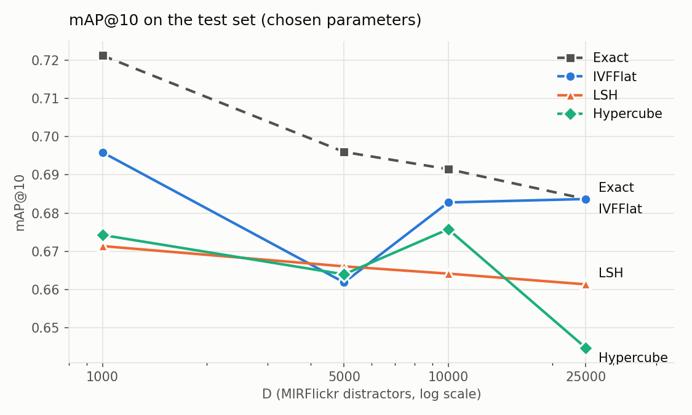
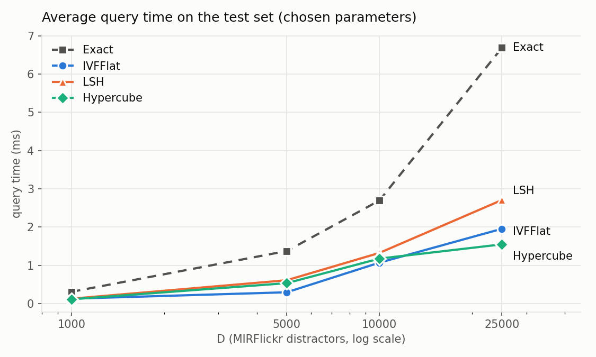
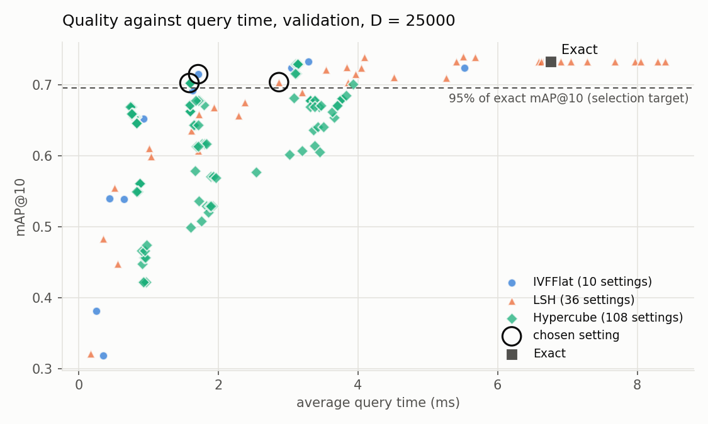
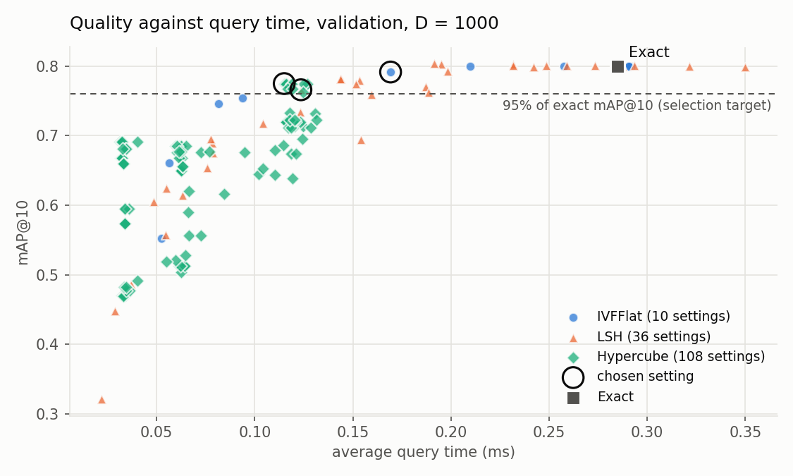

# Image Search with Vector Representations — Experimental Study

K23γ: Software Development for Algorithmic Problems, programming assignment 1,
winter semester 2026–27.

## 1. Summary

Every image is turned into a vector of dimension K = 256 (a bag of visual words
over SIFT descriptors), and four search methods are compared on these vectors:
exhaustive search (Exact), LSH, random projection on the hypercube (Hypercube)
and IVFFlat. IVFPQ was not implemented. Parameters were chosen on the
validation set and the final evaluation was done on the test set for
D ∈ {1000, 5000, 10000, 25000} MIRFlickr images.

Main results (test set, D = 25000):

| method | mAP@10 | share of Exact | query time | speed-up |
|---|---|---|---|---|
| Exact | 0.684 | 100% | 6.69 ms | 1.0× |
| IVFFlat | 0.684 | 100.0% | 1.96 ms | 3.4× |
| LSH | 0.661 | 96.7% | 2.71 ms | 2.5× |
| Hypercube | 0.645 | 94.3% | 1.55 ms | 4.3× |

- **IVFFlat** has the best quality/time trade-off: at D = 25000 it reaches the
  quality of exhaustive search with a 3.4× shorter query time.
- **Hypercube** is the fastest at D = 25000, with a small loss in quality.
- The **default values** of the assignment for LSH and Hypercube (w = 0.05) are
  far too small for our vectors: they give mAP@10 0.37 and 0.22–0.26 on
  validation. With w ≈ 0.1–0.4 the methods come close to Exact.

## 2. Data and vector representation

### 2.1 Data

- **HPatches**: 116 sequences of 6 images (57 illumination, 59 viewpoint).
  Split from `split.txt`: 70 train, 23 validation (11 i + 12 v), 23 test
  (11 i + 12 v). In every sequence image 1 is the query and images 2–6 are the
  5 relevant images.
- **MIRFlickr-25K**: the first D images in increasing order, used as
  non-relevant images (distractors). 15 images have no SIFT descriptor at all
  (im2009, im2096, im2541, im3090, im4496, im4953, im6046, im13064, im18445,
  im18976, im19300, im19322, im19593, im21455, im21828) and are replaced by the
  next one. Because of this, for D = 25000 only 24985 usable images exist and
  the database has 25100 instead of 25115 images.
- Database sizes: 1115, 5115, 10115 and 25100 images (115 HPatches + D
  MIRFlickr).

### 2.2 SIFT descriptors

All images are read in grayscale with OpenCV (4.5.4) and all their SIFT
descriptors are extracted.

| set | images | descriptors | per image (average) |
|---|---|---|---|
| HPatches (all sequences) | 696 | 3 246 831 | ~4 670 |
| MIRFlickr | 25 000 | 19 200 139 | 768 |

OpenCV's SIFT values are whole numbers 0–255, so they are stored with 1 byte
per value without any loss. The first extraction of all images took ~22
minutes. The results are kept in a cache (2.8 GB) and are read in a few
seconds by later runs.

### 2.3 Vocabulary and vectors

- Up to S = 500 random descriptors are taken from every training image: 206 120
  descriptors in total from 420 images.
- k-means (k-means++ initialisation, Lloyd's algorithm) with K = 256 centres.
  The run reached the limit of 100 iterations (~6.3 s per iteration, 10.3
  minutes in total). The mean squared error fell from 112 641 (iteration 1) to
  ~70 550. All clusters have between 301 and 2849 descriptors (none empty).
- Every image I is represented by x_I = (h_1/n_I, …, h_K/n_I), using all its
  descriptors. The vectors sum to 1 (error < 10⁻⁷). Queries use on average
  ~240 of the 256 words, database images ~181.
- The vectors were checked against an independent computation in Python
  (numpy): difference < 10⁻⁹.

The whole pipeline uses a fixed seed (1) and the same K centres for all sets.

## 3. Methods

All approximate methods collect candidate vectors and rank them by the true
Euclidean distance. The time is measured only for the search (from the moment
x_Q is available until the 10 results are returned), not for building the
indexes.

- **Exact**: compares the query with every database vector.
- **LSH** (as in the course slides): h(p) = ⌊(p·v + t)/w⌋ with v ~ N(0,1)^K,
  t ~ U[0, w). Every table has ID(p) = (Σ r_i h_i(p)) mod M with M = 2³² − 5 and
  bucket ID(p) mod TableSize, TableSize = n/8. Only the points in the bucket
  with the same ID are candidates (querying trick). L tables, duplicates
  removed. An extra optional parameter `-maxcand` (early stop, like the
  optional "> 10L" of the slides) is off in the experiments.
- **Hypercube**: d′ = `-kproj` functions h_i and random maps f_i(h_i) ∈ {0, 1}
  give a vertex of {0,1}^d′. The search checks the query's vertex, then the
  vertices at Hamming distance 1, 2, … until `-M` points or `-probes` vertices
  have been checked.
- **IVFFlat**: k-means (at most 25 iterations) on the database vectors with
  `-kclusters` clusters (default ⌈√n⌉); search in the `-nprobe` closest
  clusters.
- **IVFPQ**: not implemented.

Correctness checks: every approximate method returns exactly the ranking of
exhaustive search when it checks the whole database (IVFFlat with nprobe =
kclusters, LSH with a very large w, Hypercube with all vertices or a very large
w), on validation with D = 1000 and on test with D = 25000. The metrics were
checked against an independent computation in Python.

## 4. Experimental procedure

1. **Validation**: a grid of values for every method and every D (620 runs in
   total):

   | method | parameters | settings per D |
   |---|---|---|
   | IVFFlat | kclusters ∈ {⌈√n⌉, 2⌈√n⌉}, nprobe ∈ {1, 2, 5, 10, 20} | 10 |
   | LSH | k ∈ {4, 6, 8}, L ∈ {5, 10, 15}, w ∈ {0.1, 0.15, 0.2, 0.3} | 36 |
   | Hypercube | kproj ∈ {8, 10, 12, 14}, w ∈ {0.2, 0.3, 0.4}, M ∈ {10%, 20%, 40% of n}, probes ∈ {50, 100, 500} | 108 |

   Hypercube's M is set as a share of the database size, because a fixed M is
   too large for small D and too small for D = 25000. The values of w follow
   the rule w ≈ 4 × (average nearest-neighbour distance): the average distance
   in our database is 0.072 (D = 1000) and 0.067 (D = 25000), i.e.
   w ≈ 0.27–0.29.
2. **Selection**: for every method and D, the **fastest** setting with mAP@10
   ≥ 95% of exhaustive search's mAP@10 on validation. Every method reached the
   target at every D.
3. **Test**: every method is run with its chosen parameters. The quality is
   the same in every run; the time is the average of 3 runs.

Environment: Linux Mint 21.3 (based on Ubuntu 22.04), g++ 11.4 with -O2, 4
cores. The search runs in a single thread. In a first run, load from other
applications raised some times by up to 1.5–2×, so the test stage was repeated
on an idle system. The quality values were identical.

## 5. Chosen parameters

| method | D | parameters | mAP@10 (val) | time (val, ms) | Exact mAP@10 (val) |
|---|---|---|---|---|---|
| IVFFlat | 1000 | kclusters 68, nprobe 5 | 0.791 | 0.17 | 0.800 |
| IVFFlat | 5000 | kclusters 144, nprobe 5 | 0.768 | 0.35 | 0.784 |
| IVFFlat | 10000 | kclusters 202, nprobe 10 | 0.750 | 1.00 | 0.773 |
| IVFFlat | 25000 | kclusters 318, nprobe 10 | 0.715 | 1.71 | 0.732 |
| LSH | 1000 | k 6, L 5, w 0.2 | 0.766 | 0.12 | 0.800 |
| LSH | 5000 | k 6, L 5, w 0.2 | 0.759 | 0.62 | 0.784 |
| LSH | 10000 | k 6, L 5, w 0.2 | 0.746 | 1.32 | 0.773 |
| LSH | 25000 | k 4, L 10, w 0.1 | 0.704 | 2.87 | 0.732 |
| Hypercube | 1000 | kproj 8, w 0.4, M 446, probes 50 | 0.775 | 0.12 | 0.800 |
| Hypercube | 5000 | kproj 8, w 0.4, M 2046, probes 500 | 0.763 | 0.54 | 0.784 |
| Hypercube | 10000 | kproj 12, w 0.4, M 4046, probes 500 | 0.740 | 1.20 | 0.773 |
| Hypercube | 25000 | kproj 12, w 0.4, M 5023, probes 50 | 0.703 | 1.59 | 0.732 |

For IVFFlat, 2⌈√n⌉ clusters were chosen at every D: with more clusters every
list is shorter. The k-means clusters are very uneven (at D = 25000 with
⌈√n⌉ = 159 clusters, from 1 to 1416 vectors), and queries often fall into the
large ones, so a query is compared with a much larger part of the database
than nprobe / kclusters.

## 6. Results on the test set

### 6.1 All metrics

| method | D | Recall@5 | Recall@10 | mAP@10 | time (ms) | compared (% of database) | queries < 10 results |
|---|---|---|---|---|---|---|---|
| Exact | 1000 | 0.730 | 0.783 | 0.721 | 0.31 | 100 | 0 |
| IVFFlat | 1000 | 0.704 | 0.748 | 0.696 | 0.13 | 38.3 | 0 |
| LSH | 1000 | 0.670 | 0.722 | 0.671 | 0.13 | 39.8 | 1 |
| Hypercube | 1000 | 0.678 | 0.730 | 0.674 | 0.11 | 40.0 | 0 |
| Exact | 5000 | 0.687 | 0.757 | 0.696 | 1.38 | 100 | 0 |
| IVFFlat | 5000 | 0.652 | 0.722 | 0.662 | 0.30 | 17.6 | 0 |
| LSH | 5000 | 0.661 | 0.713 | 0.666 | 0.61 | 39.7 | 0 |
| Hypercube | 5000 | 0.661 | 0.722 | 0.664 | 0.54 | 40.0 | 0 |
| Exact | 10000 | 0.687 | 0.748 | 0.692 | 2.70 | 100 | 0 |
| IVFFlat | 10000 | 0.678 | 0.739 | 0.683 | 1.07 | 27.4 | 0 |
| LSH | 10000 | 0.661 | 0.704 | 0.664 | 1.33 | 38.9 | 0 |
| Hypercube | 10000 | 0.670 | 0.730 | 0.676 | 1.18 | 40.0 | 0 |
| Exact | 25000 | 0.670 | 0.730 | 0.684 | 6.69 | 100 | 0 |
| IVFFlat | 25000 | 0.670 | 0.730 | 0.684 | 1.96 | 18.8 | 0 |
| LSH | 25000 | 0.652 | 0.704 | 0.661 | 2.71 | 27.3 | 0 |
| Hypercube | 25000 | 0.626 | 0.696 | 0.645 | 1.55 | 20.0 | 0 |

### 6.2 Compared with exhaustive search

| D | IVFFlat | LSH | Hypercube |
|---|---|---|---|
| 1000 | 96.5%, 2.4× | 93.1%, 2.4× | 93.5%, 2.7× |
| 5000 | 95.1%, 4.6× | 95.7%, 2.2× | 95.4%, 2.6× |
| 10000 | 98.7%, 2.5× | 96.1%, 2.0× | 97.7%, 2.3× |
| 25000 | 100.0%, 3.4× | 96.7%, 2.5× | 94.3%, 4.3× |

(mAP@10 as a share of Exact's, and the speed-up of the query time.)





### 6.3 Observations

- **Quality and database size.** With more distractors the mAP@10 of
  exhaustive search drops only slightly (0.721 → 0.684 from D = 1000 to
  25000): most relevant images stay in the first 10 places. The small
  fluctuations of the approximate methods (e.g. IVFFlat at D = 5000) come from
  different chosen parameters per D and from the small number of queries (23):
  one query can change the mAP by up to ~0.04.
- **Time and database size.** The time of exhaustive search grows linearly
  with n. The approximate methods compare a roughly constant share of the
  database, so they also grow linearly, but with a smaller slope.
- **A small database.** The database is small (≤ 25100 vectors of dimension
  256), so even exhaustive search needs only ~7 ms. The approximate methods
  have their own overhead (hashing, finding vertices or centroids, scattered
  memory access), so they only win when they compare a small share of the
  database. On validation, LSH settings that compare more than ~80% of the
  database are slower than Exact.
- **From validation to test.** mAP@10 on test is lower than on validation for
  every method, Exact included (e.g. 0.732 → 0.684 at D = 25000): the test
  queries are harder. The ratio to Exact stays close to the 95% target
  (94.3%–100% at D = 25000).

## 7. Quality against time

The figures show all validation settings for D = 25000 and D = 1000. The ring
marks the chosen setting of each method, the dashed line the 95% target.





- At D = 25000 the best IVFFlat and Hypercube settings reach the target in
  ~1.6–1.7 ms, LSH in ~2.9 ms. LSH needs more comparisons for the same
  quality.
- Settings with a very short time (< 1 ms) lose a lot of quality (mAP@10
  0.3–0.67): they only compare the very closest images.
- At D = 1000 all methods are below 0.35 ms; the time differences are in the
  order of 0.1 ms.

## 8. Illumination and viewpoint

mAP@10 on test, separately for the 11 illumination and the 12 viewpoint
sequences:

| method | D = 1000 illum. | D = 1000 viewp. | D = 25000 illum. | D = 25000 viewp. |
|---|---|---|---|---|
| Exact | 0.695 | 0.745 | 0.678 | 0.689 |
| IVFFlat | 0.646 | 0.741 | 0.678 | 0.689 |
| LSH | 0.649 | 0.692 | 0.631 | 0.689 |
| Hypercube | 0.698 | 0.653 | 0.611 | 0.676 |

- For exhaustive search the viewpoint sequences are slightly easier at every
  D (also on validation: 0.757 against 0.839 for D = 1000).
- At D = 25000 the approximate methods lose more on the illumination
  sequences (e.g. Hypercube: 0.611 against Exact's 0.678, while on viewpoint
  0.676 against 0.689). At D = 1000 the picture is mixed: IVFFlat loses on
  illumination, Hypercube on viewpoint.
- With 11–12 queries per group the differences are small in absolute numbers
  of queries and should be read with care.

## 9. Queries with fewer than 10 results

- Only LSH ever returns fewer than 10 results: in 29 of the 144 validation runs
  (74 queries in total), all with k ≥ 6 and w ≤ 0.2, where the buckets are very
  small, and more often at small D (fewer distractors to fill the places).
  IVFFlat and Hypercube always found enough candidates.
- On test: 1 query (LSH, D = 1000).
- With the default values of the assignment (validation, D = 1000): 7 queries
  for LSH and 2 for Hypercube with fewer than 10 results. The missing places
  are written as `Rank-k: -` and count as not relevant.

## 10. Default values of the assignment

| method | D | defaults | mAP@10 (val) | chosen setting (val) |
|---|---|---|---|---|
| LSH | 1000 | k 4, L 5, w 0.05 | 0.374 | 0.766 |
| LSH | 25000 | k 4, L 5, w 0.05 | 0.374 | 0.704 |
| Hypercube | 1000 | kproj 10, w 0.05, M 500, probes 10 | 0.261 | 0.775 |
| Hypercube | 25000 | kproj 10, w 0.05, M 500, probes 10 | 0.222 | 0.703 |
| IVFFlat | 1000 | kclusters ⌈√n⌉ = 34, nprobe 5 | 0.800 | 0.791 |
| IVFFlat | 25000 | kclusters ⌈√n⌉ = 159, nprobe 5 | 0.692 | 0.715 |

The vectors sum to 1 and the distances between them are around 0.07, so with
w = 0.05 the cells are very narrow: even two photos of the same scene rarely
share a bucket or a vertex, and the methods find almost only the single
closest image. With w ≈ 4 × (average nearest-neighbour distance) ≈ 0.27–0.29
the methods work as expected. IVFFlat already works well with its defaults (at
D = 1000 it checks ~69% of the database). There, the chosen setting has a
slightly lower mAP@10 than the default, because the selection rule asks for
the fastest setting above the target (0.17 ms against 0.21 ms), not the most
accurate one.

With LSH's early stop (`-maxcand`, validation, D = 25000, k 6, L 10, w 0.2)
mAP@10 drops from 0.732 (no limit, 5.6 ms) to 0.619 with 1000 candidates
(0.33 ms) and to 0.554 with 100 = 10L candidates (0.05 ms). It is a simple
speed/quality knob, but for the same number of comparisons a smaller w without
a limit usually gives better quality: the limit keeps the first candidates
found, not the closest ones.

## 11. Index build time

Not part of the query time (test, chosen parameters):

| method | D = 1000 | D = 5000 | D = 10000 | D = 25000 |
|---|---|---|---|---|
| IVFFlat (k-means) | 0.48 s | 4.6 s | 12.7 s | 49.5 s |
| LSH | 0.01 s | 0.04 s | 0.09 s | 0.28 s |
| Hypercube | < 0.01 s | 0.01 s | 0.04 s | 0.09 s |

IVFFlat is faster to search but takes much longer to build (k-means on the
whole database). LSH and Hypercube are built almost instantly.

## 12. Conclusions

1. All three approximate methods reach ~93–100% of the quality of exhaustive
   search with a 2–4.6× shorter query time.
2. **IVFFlat** has the best quality/time trade-off at most D and the same
   quality as Exact at D = 25000, at the cost of the longest build time.
3. **Hypercube** is the fastest at D = 25000 and is built instantly, with a
   ~6% loss in mAP@10.
4. **LSH** has the weakest quality/time trade-off, because of its cost per
   candidate (L·k projections, many buckets), and it is the only method that
   sometimes returns fewer than 10 results.
5. The parameters must match the scale of the data: w has to be compared with
   the distances between the vectors, and Hypercube's M has to grow with the
   database size.
6. Because the database is small, the speed-up is moderate. On larger
   databases the approximate methods would have a bigger advantage.

## Appendix: reproduction

```bash
make
./run_experiments.sh          # validation, selection, test (~15 min with a full cache)
python3 make_plots.py         # figures in results/plots/
```

The results are in `results/experiments/`: `validation.csv`, `chosen.csv`,
`test.csv`, `summary.md` and the output file of every run. A first run without
a cache needs an extra ~45 minutes (SIFT, vocabulary, vectors).
